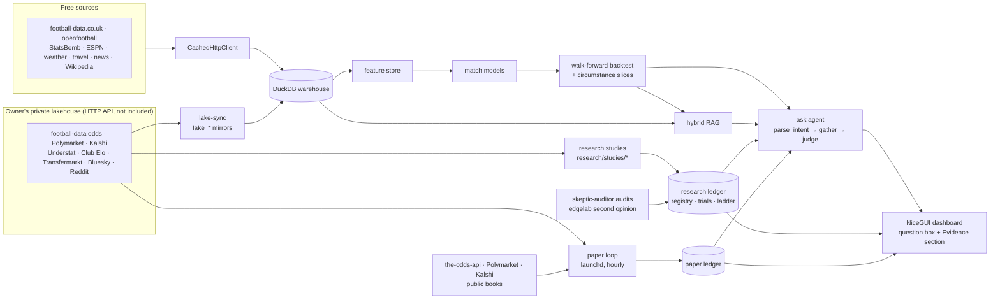

# PITCH-EDGE

[](https://github.com/hampustalhandske/pitch-edge/actions/workflows/ci.yml)

A Python research platform for football (soccer) betting markets. It asks one question over and over: does
any rule built only from information available before kickoff beat the sharp closing price? Each idea is
pre-registered, run as counted trials, scored against the de-vigged sharp close with block-bootstrap
uncertainty, graded on an evidence ladder (L0 registered → L5 forward paper-traded), audited, and written up —
including when it fails, which is most of the time.

Alongside the research layer sit a walk-forward backtest pipeline over the project's own match models and a
LangGraph `ask` agent that answers three standard questions ("top N bets", "team A vs team B", "what's on day
X") from that evidence.

> **Hard guardrails.** No code path places a bet or moves money; there is no staking or order-placement code.
> The forward test is paper only: it reads public market data and logs paper decisions. Every number the `ask`
> agent states traces back to a walk-forward backtest, the research ledger or a real market price, and is
> labelled with its evidence rung.

## Current results

Display floor **L4**, **no validated edge**. The findings at the top rung are predictive, not strategies:

- **Cross-book closing-line model (R6, L4):** using every bookmaker's opening quote predicts the de-vigged
  Pinnacle close better than a consensus-gap baseline — +6.61e-5 bits [5.75e-5, 7.41e-5], n=45,467 — real but
  only about 2% of the open→close divergence.
- **Book informativeness (R6, L4):** VC and Betfair opening deviations carry information about where Pinnacle
  closes; BW, IW and 1xBet quotes are stale.
- The best *strategy* rung is L2 (best-available "max" opening odds beating Pinnacle's fair open, an upper bound
  on prices nobody can reliably get). Polymarket, Kalshi, crowd-attention and the other bookmaker-structure
  studies are null or artefacts.

One line per study, with links: [`reports/CASE_STUDY.md`](reports/CASE_STUDY.md). Live ladder:
`pitch-edge research status`.

## Quickstart

On an Apple-silicon Mac whose shell runs under Rosetta, prefix every `uv` command with `arch -arm64`.

```bash
uv sync --extra dev                      # Python 3.11
uv run pytest                            # unit + integration tests, network mocked
uv run pitch-edge refresh                # ingest → features → backtests → RAG index
uv run pitch-edge serve                  # dashboard on :8501
uv run pitch-edge ask "top 4 bets"       # also "Liverpool vs Arsenal", "what's on 2024-03-16"; --as-of YYYY-MM-DD
```

`ask` needs an LLM: a local `ollama serve` (default model `llama3.1:8b`), or `PITCH_EDGE_LLM_PROVIDER=groq`
with `GROQ_CLOUD_API_KEY` set. The research and paper commands need access to the private lakehouse API (`LAKEHOUSE_API_URL`,
`LAKEHOUSE_API_TOKEN` in `.env`); the paper loop's bookmaker quotes need `ODDS_API_KEY`. `uv run pitch-edge
setup` walks through the optional keys; see `API_KEYS.md`.

```bash
uv run pitch-edge lake-sync [--only fd_matches] [--full-refresh]   # mirror lakehouse tables (resumable)
uv run pitch-edge research status                                  # every hypothesis, its trials and rung
uv run pitch-edge research grade <hypothesis-id>                   # the ladder, gate by gate
uv run pitch-edge paper status | report                            # forward paper ledger
uv run pitch-edge backtest | ablation | rag-eval | health | export
uv run pitch-edge ingest-pmxt <start> <end> && uv run pitch-edge map-pmxt   # Polymarket order-book archive
uv run pitch-edge backtest-timing                                  # entry-timing backtest on Polymarket ticks
```

## Architecture



## Research layer

- **Protocol.** A hypothesis is a YAML file in `research/registry/` (direction, primary metric, disconfirming
  result, window, decision timestamp, family, parameter grid), registered on the ledger before any outcome is
  scored. Every grid point is a trial; the ledger (`data/research/ledger.duckdb`) is append-only and
  hash-chained, so dropped ideas still count toward multiple-testing corrections.
- **Ladder.** `research/STANDARDS.md`: L1 point-in-time and reproducible, L2 out-of-sample CI excluding zero on
  ≥ 300 decisions, L3 survives search (BH across the family, deflated Sharpe, PBO, effect-size ceiling,
  sub-period and leave-one-league-out stability), L4 independent (auditor re-derivation, edgelab grade), L5
  forward paper record. Benchmarks are the de-vigged Pinnacle close (through 2025-09) and the Betfair Exchange
  close after that.
- **Code.** `src/pitch_edge/research/` (registry, ledger, trial runner, stats, de-vig, gates, evidence summary)
  and `pitch-edge research {register|status|grade|ledger|import-trials|review}`. Study code and `REPORT.md` per
  study under `research/studies/`; audits under `research/audits/`.
- **Lake bridge.** `src/pitch_edge/lake/` reads the lakehouse API and mirrors ten tables into `lake_*` warehouse
  tables, each with a known-at column for point-in-time filtering; syncs are checkpointed per window and resume
  where they stopped.
- **edgelab bridge.** `src/pitch_edge/edgelab/` exports a binary-market dataset and scaffolds a strategy in the
  layout the owner's private edgelab grading engine reads (not included).
- **Paper loop.** `src/pitch_edge/paper/` + `scripts/paper_loop.sh` (launchd; see `scripts/README.md`): hourly
  collection of Polymarket, Kalshi and the-odds-api quotes into `data/paper/paper.duckdb`, immutable paper
  decisions by each registered strategy on fixtures that have not kicked off, daily settlement against the
  lake's closing prices.

## Match models and backtests

One `MatchModel` interface (`fit`, `predict_proba`, `card`), identical walk-forward folds, no market-odds
feature on any model:

| Model | What it is |
|---|---|
| `dixon_coles` | bivariate Poisson with τ correction and exponential time decay, one bounded MLE fit per league |
| `gbdt` | histogram GBDT (LightGBM if installed, else scikit-learn HGB) on Elo, form, rest/travel, referee, weather, news features |
| `stochastic_strength` | team strength as a mean-reverting Ornstein-Uhlenbeck process on Elo, outcome probabilities by Monte Carlo |
| `transformer_sequence` | PyTorch Lightning `TransformerEncoder` over each team's recent match sequence |
| `sentiment_only` | multinomial logistic regression on news sentiment/injury features only |

`pitch-edge backtest` trains strictly before each fold, prices bets at real quoted odds (Pinnacle early when
present), measures CLV against the close, runs ¼-Kelly, ½-Kelly and flat staking, and writes a one-page
`reports/<label>/CASE_STUDY.md` plus CSVs, model cards and circumstance-sliced evidence
(`slice_evidence.csv`) under `data/backtest/<label>/` (gitignored). `pitch-edge backtest-timing` compares
entry policies on real Polymarket order-book ticks. Every model so far loses to the closing price.

## `ask` agent and dashboard

`agents/qa_graph.py`, answered as of an explicit historical date (`--as-of`, default: the most recent real
closing-odds date; the agent reads no live odds):

- **`parse_intent`** — LLM structured output into `top_bets`, `fixture`, `fixtures_on_day` or `unrecognized`.
- **`gather`** — deterministic: candidate fixtures (a real early Pinnacle quote is required; for "top N bets"
  also a mapped Polymarket market), a fresh fit of `models.default_models()` (Dixon-Coles, GBDT, stochastic
  strength) on data strictly before `as_of`, the no-vig market edge, the model to trust per fixture from
  circumstance-matched backtest evidence, and each candidate's evidence status from the research ledger. No
  `ask` model has a graded hypothesis yet, so every candidate is a model-vs-market disagreement below the
  floor.
- **`judge`** — a bounded tool-calling agent (`agents/evidence_tools.py`: `get_model_predictions`,
  `get_backtest_evidence`, `get_price_history`, `search_context`, `research_status`, `paper_status`) that
  narrates the batch with citations checked by `rag/generate.py::verify_citations`. It states the rung behind
  what it narrates and says plainly when no validated edge exists. It never computes a probability or an edge.

RAG: Chroma + sentence-transformers fused with BM25 by reciprocal-rank fusion, cross-encoder reranked;
generation tries the configured provider (Ollama or Groq), then Claude if `ANTHROPIC_API_KEY` is set, then a
deterministic template.

`pitch-edge serve` runs a NiceGUI page: a question box for the same graph, and a read-only Evidence section
(best rung and champion per research family, the display floor, and the paper ledger's forward record per
strategy). It opens short-lived read-only connections only.

## Layout

```
src/pitch_edge/
  cli.py                  the `pitch-edge` command (Typer); research/ and paper/ add sub-apps
  config.py, keys.py      settings from env/.env; optional-key registry behind `pitch-edge setup`
  research/               registry, ledger, trial runner, stats, de-vig, ladder gates, evidence summary
  lake/                   lakehouse API client and lake_* mirrors
  paper/                  collectors, strategies, store, settlement, report for the paper ledger
  edgelab/                dataset export and strategy scaffold for edgelab
  data/                   CachedHttpClient, pandera contracts, sources/, alt/ (odds, weather, travel,
                          referee, news, Wikipedia, Polymarket archive), DuckDB warehouse, ingestion
  features/               pre-match feature store (see features/README.md)
  models/                 dixon_coles, gbdt, stochastic, sequence, sentiment, calibration
  backtest/               walk-forward engine, staking, metrics, slices.py, as_of.py, tick timing, report
  odds/                   odds providers, no-vig maths, steam/divergence detection
  rag/                    documents, hybrid retrieval, grounded generator, ask-intent parser
  agents/                 the `ask` graph (qa_graph, qa_data, qa_context, evidence_tools, llm)
  dashboard/              web.py (NiceGUI), theme.py
  vendor/                 vendored WhoScored scraper (see vendor/NOTICE.md; not wired into ingestion)
research/                 STANDARDS, registry/, studies/, audits/
reports/                  CASE_STUDY.md index and per-backtest write-ups
scripts/                  paper loop, launchd agent, warehouse summary (see scripts/README.md)
tests/                    pytest unit + integration tests, network mocked
```

## Docs

`reports/CASE_STUDY.md` (study index), `research/STANDARDS.md` (the ladder), `API_KEYS.md`, `scripts/README.md`,
`src/pitch_edge/features/README.md`, `src/pitch_edge/vendor/NOTICE.md`.
